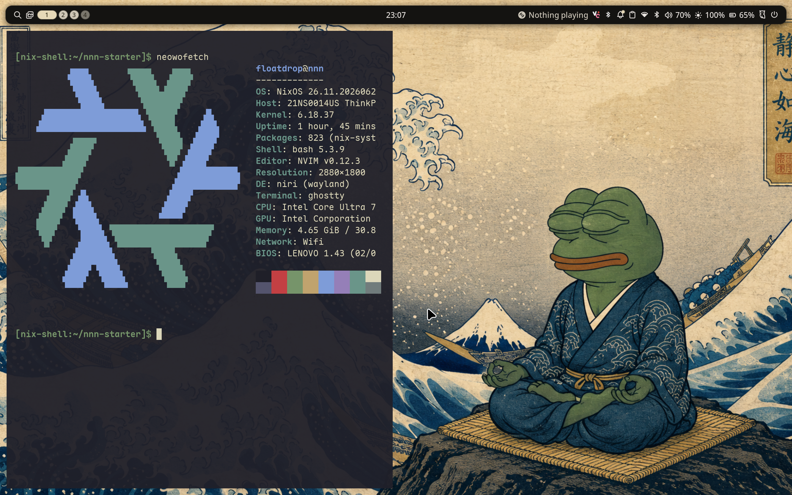

# dotfiles

[](https://github.com/BobWorts/dotfiles/actions/workflows/check.yml)

[](https://builtwithnix.org)


<p align="center">
  
</p>

> Three letters, zero compromise, now with batteries included.
>
> My personal **NNN** desktop, built on
> [nnn-starter](https://github.com/floatdrop/nnn-starter), an opinionated
> [omarchy](https://omarchy.org)-style starter for [NixOS + niri +
> Noctalia](https://the-nnn-stack.github.io).

## What you get

- **Compositor** — [niri](https://github.com/YaLTeR/niri)
- **Shell/UI** — [Noctalia](https://github.com/noctalia-dev/noctalia), bar,
  launcher, lock screen, control center
- **Theming** — [Stylix](https://github.com/nix-community/stylix)
- **Terminal** — [kitty](https://sw.kovidgoyal.net/kitty/)
- **Prompt** — fish + [Starship](https://starship.rs)
- **Editor** — [Zed](https://zed.dev), nano
- **Browser** — [Zen](https://zen-browser.app), beta channel
- **Files** — [Nautilus](https://apps.gnome.org/Nautilus/)
- **Font** — Maple Mono NF
- **Login** — greetd + tuigreet
- **CLI** — lsd, fzf, bat, btop, ripgrep, fd, zoxide, dust, duf, procs, gping, tealdeer, jq, lazygit, delta, direnv, nh

## Requirements

- A NixOS machine or the live NixOS installer
- `git` and `sudo`
- Flakes enabled (`experimental-features = nix-command flakes`); the live
  installer ships with it, on an installed machine add it to
  `/etc/nix/nix.conf` before step 5

## Quick start

```sh
# 1. Clone into the live NixOS installer or your home directory.
git clone https://github.com/BobWorts/dotfiles ~/dotfiles
cd ~/dotfiles

# 2. Copy the template and fill in your identity.
#    This guide uses hostName = "template", substitute your own name.
cp local.example.nix local.nix
$EDITOR local.nix

# 3. Create your host folder from the shipped template.
#    The folder name must match hostName from local.nix.
cp -a hosts/example hosts/template

# 4. Generate the real hardware config for this machine.
sudo nixos-generate-config --show-hardware-config > hosts/template/hardware-configuration.nix

# 5. Build and switch. path: keeps the gitignored local.nix visible.
sudo nixos-rebuild switch --flake path:.#template
```

## Placeholders to edit

Personal settings live in `local.nix`, copied from the tracked
[`local.example.nix`](local.example.nix) in step 2. Without it, a fresh clone
falls back to the example and warns during evaluation.

| What | Where |
|------|-------|
| Username, hostname, full name, auto-login, git, timezone, locale, layouts, outputs, QEMU | `local.nix` |
| Hardware | `hosts/<hostName>/hardware-configuration.nix`, step 4 |

> Build through `path:`, as in step 5. Flakes skip gitignored files, and `nh`
> is configured with it already.

## Key bindings, niri

### General

| Keys | Action |
|------|--------|
| `Print` | Screenshot |
| `Mod`+`Tab` | Window switcher |
| `Mod`+`Space` | Noctalia launcher |

### Applications

| Keys | Action |
|------|--------|
| `Mod`+`Return` | Terminal, kitty |
| `Mod`+`B` | Browser, Zen |
| `Mod`+`E` | Files, Nautilus |

### Windows

| Keys | Action |
|------|--------|
| `Mod`+`←`/`↓`/`↑`/`→` | Focus |
| `Mod`+`Shift`+`←`/`↓`/`↑`/`→` | Move |
| `Mod`+`Q` | Close |
| `Mod`+`F` / `Mod`+`Shift`+`F` | Maximize / fullscreen |
| `Mod`+`V` / `Mod`+`W` | Float / tab |
| `Mod`+`R` | Preset column width |
| `Mod`+`Minus` / `Mod`+`Equal` | Column width down / up |
| `Mod`+`Shift`+`Minus` / `Mod`+`Shift`+`Equal` | Window height down / up |
| `Mod`+`[` / `Mod`+`]` | Consume or expel left / right |
| `Mod`+`,` / `Mod`+`.` | Merge into column / expel |

### Workspaces

| Keys | Action |
|------|--------|
| `Mod`+`1`…`5` | Switch workspace |
| `Mod`+`Shift`+`1`…`5` | Move window to workspace |

Volume, mute, playback and brightness are the XF86 media keys, wired to `wpctl`,
`playerctl` and `brightnessctl`. `Mod`+`Shift`+`/` shows the full overlay,
`Mod`+`Shift`+`E` quits niri.

## Gallery

Coming soon.

## CI

[`.github/workflows/check.yml`](.github/workflows/check.yml) runs on pushes to
`main` and on pull requests (README and `media/` changes are ignored). The
eval-only `ci` twin evaluates the same module tree with a dummy root device, so
it works on a fresh clone where the hardware file is still a placeholder.

- **eval**: `nix eval .#nixosConfigurations.ci.config.system.build.toplevel.drvPath`,
  catches option typos and niri schema errors
- **lint**: `alejandra --check`, `statix`, `deadnix`
- **build**: realises the full system closure of `ci`, on `main` and manual
  dispatch, with niri and noctalia prebuilt from their caches

A separate manual `format` workflow runs alejandra and commits the result.

> Keep `flake.lock` committed so CI and your machines resolve identical inputs.

## Notes

- Theming is one base16 file under `themes/`, applied by Stylix everywhere.
- niri and noctalia would otherwise compile for about an hour. Both come
  prebuilt: noctalia tracks its `cachix` branch, where upstream pushes only
  after a build reaches `noctalia.cachix.org`; niri is pinned to the last
  commit with a green cache build. Neither input may follow our `nixpkgs`, a
  different nixpkgs means a cache miss.

## Credits

- [nnn-starter](https://github.com/floatdrop/nnn-starter), the base this repo
  started from
- [the NNN stack](https://the-nnn-stack.github.io), and its community
- [niri](https://github.com/YaLTeR/niri)
- [Noctalia](https://github.com/noctalia-dev/noctalia)
- [Stylix](https://github.com/nix-community/stylix)
